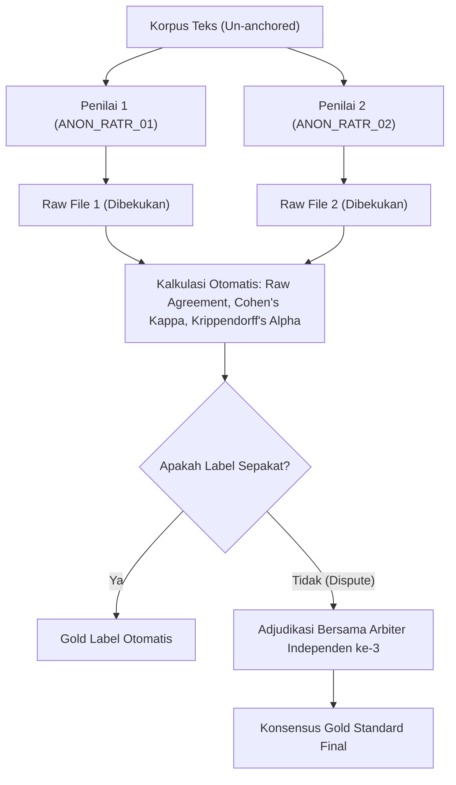

# PEDOMAN ANOTASI INDEPENDEN 9 EMOSI PLUTCHIK
## Studi Diskursus Program Makan Bergizi Gratis (MBG) pada Platform Media Sosial X

**Versi:** 2.0 (Standar Validasi Ilmiah Double-Blind Scopus Q1)  
**Status Dokumen:** Dibekukan untuk Evaluasi Independen  
**Prinsip Utama:** Independen penuh, tanpa bocoran label model (*un-anchored*), tanpa interaksi antar-penilai sebelum adjudikasi formal.

---

### 1. Prinsip Metodologis & Integritas Penilaian

1. **Kebutaan Ganda (Double-Blind):**
   - Penilai 1 dan Penilai 2 bekerja secara terpisah dan mandiri.
   - Dilarang berkomunikasi, mendiskusikan sampel, atau membandingkan pilihan label sebelum seluruh proses anotasi selesai.
   - Seluruh kolom prediksi model (`indobert_prediction`), label heuristik (`silver_label`), maupun identitas penilai lain **wajib disembunyikan total**.
2. **Kemandirian Berkas Mentah:**
   - Berkas hasil anotasi awal dari masing-masing penilai dibekukan sebagai *raw un-adjudicated labels*.
   - Koefisien kesepakatan (Cohen's $\kappa$ dan Krippendorff's $\alpha$) dihitung **langsung dari berkas mentah ini**, bukan setelah konsensus.
3. **Objektivitas Linguistik:**
   - Penilaian didasarkan pada penanda tekstual (*textual evidence*) dan fungsi pragmatis tuturan, bukan opini politik subjektif penilai terhadap program pemerintah.

---

### 2. Definisi Operasional & Indikator Linguistik 9 Emosi

Setiap teks wajib diberi **satu label emosi dominan** dari 9 kategori emosi berikut:

| No | Label Emosi | Definisi Operasional | Indikator Linguistik & Contoh Konteks |
| :---: | :--- | :--- | :--- |
| 1 | **Jijik (Disgust)** | Penolakan visceral/fisik terhadap kualitas makanan buruk (basi, bau, ulat, racun) atau penolakan moral/etika yang tajam terhadap korupsi, kecurangan, dan eksploitasi anggaran MBG. | *Kata kunci:* basi, bau, ulat, belatung, mual, muntah, menjijikkan, najis, korupsi, maling, bancakan, cuan elit. *Contoh:* "Gila masa lauknya udah berbau kecut begini dikasih ke anak SD, menjijikkan banget!" |
| 2 | **Percaya (Trust)** | Afirmasi, optimisme terukur, apresiasi terhadap integritas penyelenggara, transparansi, serta dukungan rasional atas manfaat program gizi nasional. | *Kata kunci:* transparan, amanah, akuntabel, profesional, semoga berkah, langkah nyata, mantap pemprov, kami dukung. *Contoh:* "Langkah konkret BGN menggandeng UMKM lokal patut diapresiasi, distribusinya terbuka." |
| 3 | **Netral (Neutral)** | Laporan fakta jurnalistik, agregasi data statistik, infografis anggaran, regulasi prosedural, atau pernyataan objektif tanpa muatan afektif positif maupun negatif. | *Kata kunci:* anggaran Rp..., dimulai tanggal..., juknis, survei BPS, rapat koordinasi, siaran pers resmi. *Contoh:* "BGN mengumumkan alokasi anggaran tahap pertama senilai 71 triliun rupiah untuk 2025." |
| 4 | **Tertarik (Anticipation/Interest)** | Antusiasme menunggu peluncuran/menu, rasa ingin tahu teknis, pertanyaan konstruktif, eksplorasi rencana, atau pemantauan proaktif tanpa sentimen jijik/marah. | *Kata kunci:* penasaran, pengen tahu, kira-kira kapan, menanti, menu besok apa ya, jadwal distribusi, evaluasi berkala. *Contoh:* "Penasaran sama variasi menu di daerah 3T nanti gimana standarisasi kalorinya?" |
| 5 | **Marah (Anger)** | Kemarahan eksplisit, agresi verbal, kecaman keras, tuntutan sanksi, atau makian meledak-ledak terhadap kelalaian pejabat/vendor tanpa fokus pada aspek visceral fisik. | *Kata kunci:* brengsek, pecat, keterlaluan, bajingan, usut tuntas, penjarakan, gak punya otak, lalai. *Contoh:* "Pecat kepala dinasnya! Jangan cuma minta maaf kalau anak-anak sampai masuk RS!" |
| 6 | **Sedih (Sadness)** | Kesedihan mendalam, keprihatinan emosional, rasa iba/empati terhadap anak-anak sekolah yang menjadi korban, perasaan kecewa yang melumpuhkan, atau ratapan duka. | *Kata kunci:* kasihan, pilu, miris, sedih banget, tega sekali, menetes air mata, nasib anak bangsa. *Contoh:* "Miris dan sedih liat anak-anak nahan lapar karena jatah makanannya gak kunjung datang." |
| 7 | **Takut (Fear)** | Kekhawatiran mendalam, kecemasan terhadap bahaya keselamatan fisik anak (keracunan massal), atau ketakutan sistemik akan kebangkrutan fiskal/utang negara. | *Kata kunci:* was-was, khawatir, takutnya, ngeri, cemas, bahaya keracunan, trauma makan siang. *Contoh:* "Jujur was-was kalau anak makan makanan katering tanpa uji lab harian, takut keracunan." |
| 8 | **Bahagia (Joy)** | Sukacita murni, ekspresi syukur, tawa gembira, perayaan kebahagiaan anak-anak menikmati hidangan lezat dan bernutrisi secara tulus. | *Kata kunci:* alhamdulillah enak, senang sekali, senyum bahagia, lahap makannya, bersyukur, ceria. *Contoh:* "Senang banget liat senyum adik-adik makan siang ayam kecap dengan lahap hari ini!" |
| 9 | **Kaget (Surprise)** | Keterkejutan mendadak, syok, rasa tidak menyangka atas fakta mengejutkan yang baru terungkap terkait implementasi atau pengungkapan kasus MBG. | *Kata kunci:* kaget, hah seriusan, astaga, shock, di luar nalar, plot twist, gak nyangka sama sekali. *Contoh:* "Hah seriusan anggarannya dipotong sampai 5 ribu per porsi? Gak nyangka bakal seekstrem itu!" |

---

### 3. Protokol Penanganan Kasus Kompleks (Decision Rules)

1. **Sarkasme dan Sindiran (Irony/Sarcasm):**
   - **Aturan:** Anotasi didasarkan pada **makna pragmatis tersirat (*illocutionary intent*)**, bukan makna literal permukaan.
   - *Kasus:* "Wah bergizi sekali ya telurnya ada bonus ulat sutra gratis!"
   - *Keputusan:* Labelkan sebagai **Jijik** (penolakan sarkastik atas makanan rusak), **bukan** Percaya atau Bahagia.
2. **Emosi Campuran (Mixed Emotions):**
   - **Aturan:** Tentukan **afek dominan** yang menjadi penggerak utama pesan (*primary communicative payload*).
   - *Kasus:* Teks memuat rasa kasihan pada anak sekolah (Sedih) lalu diakhiri makian menuntut pejabat dipenjara (Marah).
   - *Pedoman:* Jika tujuan tuturan adalah menyerang dan melampiaskan kemurkaan pertanggungjawaban publik, pilih **Marah**. Jika fokusnya pada ratapan duka penderitaan korban, pilih **Sedih**. Catat nuansa campuran pada kolom `annotation_notes`.
3. **Ambiguitas dan Teks Tanpa Konteks Emosi:**
   - **Aturan:** Jika teks hanya berupa tautan berita, tanya-jawab faktual singkat tanpa penanda afektif (emotikon, tanda seru ganda, leksikon afektif), masukkan ke **Netral**. Jangan memaksakan label polaritas jika tidak didukung indikator tekstual.
4. **Pembedaan Tegas Kelas Dekat (Disambiguasi Kritis):**
   - **Jijik vs. Marah:**
     - Fokus pada pembusukan makanan fisik atau korupsi/kebobrokan moral $\rightarrow$ **Jijik**.
     - Fokus pada agresi verbal, ancaman hukuman, bentakan politis langsung $\rightarrow$ **Marah**.
   - **Takut vs. Sedih:**
     - Mengantisipasi ancaman bahaya masa depan yang mencemaskan $\rightarrow$ **Takut**.
     - Meratapi dampak kerugian/penderitaan masa lalu dan rasa iba $\rightarrow$ **Sedih**.
   - **Tertarik vs. Percaya:**
     - Pertanyaan prospektif, rasa ingin tahu, menunggu jadwal $\rightarrow$ **Tertarik**.
     - Pengakuan afirmatif, keyakinan positif bahwa program berjalan baik $\rightarrow$ **Percaya**.

---

### 4. Skala Keyakinan (*Confidence Score*)

Setiap baris wajib dilengkapi nilai keyakinan penilai:
- **5 (Sangat Yakin):** Makna eksplisit, penanda leksikal kuat, tanpa ambiguitas.
- **4 (Yakin):** Makna tersirat jelas meskipun tanpa kata kunci eksplisit.
- **3 (Cukup Yakin):** Memuat sarkasme halus atau afeksi ganda, namun afek dominan masih dapat diidentifikasi.
- **2 (Ragu):** Sangat bergantung pada spekulasi konteks eksternal di luar cuitan.
- **1 (Sangat Ragu):** Teks sangat terfragmentasi / ambigu tingkat tinggi.

---

### 5. Alur Adjudikasi & Pembentukan Label Emas (Gold Standard)

1. **Tahap 1 (Raw Freeze):** Hasil mentah disimpan dan dievaluasi reliabilitas inter-raters-nya secara matematis.
2. **Tahap 2 (Dispute Identification):** Seluruh baris di mana $\text{Label}_1 \neq \text{Label}_2$ disaring otomatis.
3. **Tahap 3 (Adjudication):** Arbiter ketiga bersama kedua penilai mendiskusikan perbedaan berdasarkan pedoman ini untuk memutuskan $\text{Gold Label}$, disertai alasan pada kolom `adjudication_rationale`.
