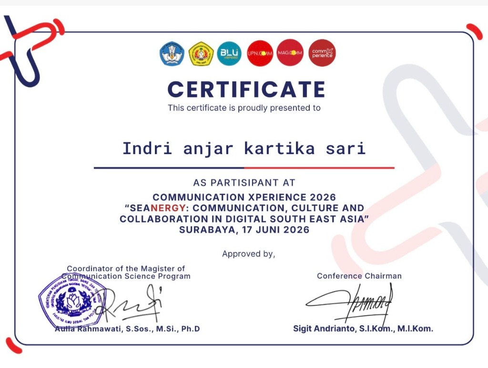

# 📜 Sertifikat Partisipasi Konferensi Akademik

### Communication Xperience 2026 — UPN "Veteran" Jawa Timur

---

### Informasi Detail Sertifikat

| Parameter | Keterangan Dokumen Resmi |
| :--- | :--- |
| **Nama Penerima** | **Indri anjar kartika sari** |
| **Status / Peran** | **Participant (*Peserta Konferensi Akademik*)** |
| **Nama Konferensi** | **COMMUNICATION XPERIENCE 2026** |
| **Tema Konferensi** | *"SEANERGY: COMMUNICATION, CULTURE AND COLLABORATION IN DIGITAL SOUTH EAST ASIA"* |
| **Institusi Penyelenggara** | Program Magister Ilmu Komunikasi, Fakultas Ilmu Sosial dan Ilmu Politik (FISIP), Universitas Pembangunan Nasional "Veteran" Jawa Timur |
| **Waktu & Tempat** | Surabaya, 17 Juni 2026 |
| **Pejabat Penandatangan 1** | **Aulia Rahmawati, S.Sos., M.Si., Ph.D** (*Coordinator of the Magister of Communication Science Program*) |
| **Pejabat Penandatangan 2** | **Sigit Andrianto, S.I.Kom., M.I.Kom.** (*Conference Chairman*) |
| **Status Validasi** | ✅ **Tervalidasi Resmi (Cap & Tanda Tangan Program Studi Magister Ilmu Komunikasi UPN Veteran Jatim)** |

---

### Integrasi dengan Riset Tesis MBG
Konferensi *Communication Xperience 2026* mengkaji dinamika komunikasi digital, budaya jejaring, dan kolaborasi di Asia Tenggara (*Digital South East Asia*), selaras dengan fokus tesis penelitian mengenai analisis jaringan komunikasi kebijakan digital, analisis sentimen berbasis aspek (ABSA), dan pemodelan emosi warganet Indonesia pada platform media sosial X.
